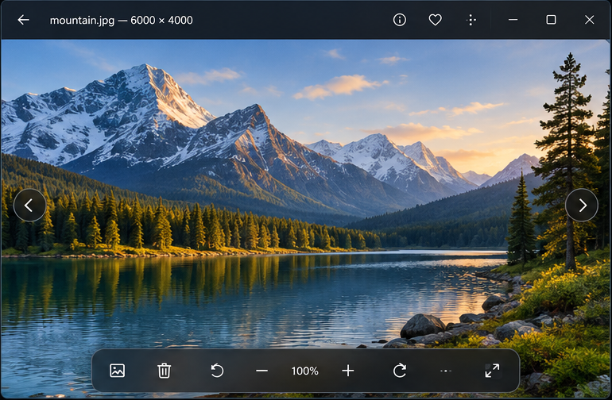
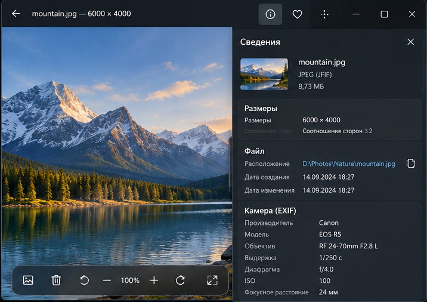
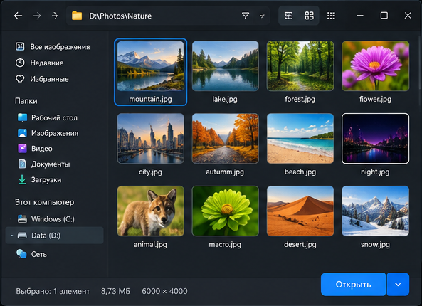
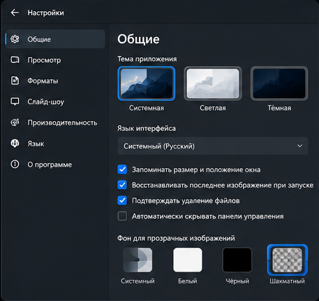
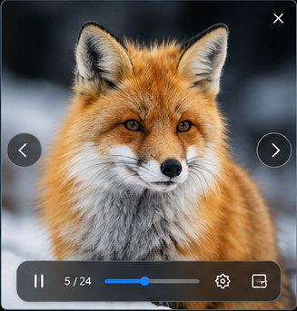

# Техническое задание: кроссплатформенная программа просмотра изображений

## 1. Назначение

Разработать лёгкую и максимально пользовательски дружелюбную программу просмотра изображений для Windows и Linux. По функциональной простоте приложение должно напоминать классический **Windows Photo Viewer из Windows 7**, а визуально — соответствовать современному стилю **Windows 11**.

Основные принципы: быстрый запуск, минимум лишних элементов, максимальная площадь под изображение, мгновенная навигация по изображениям в каталоге, единая кодовая база и адаптация оформления к системной теме Windows или Linux.

## 2. Технологический стек

- Язык разработки: **Go**.
- Графический движок: **github.com/oops1/headless-gui**.
- Целевые ОС: Windows 10/11 и актуальные Linux-дистрибутивы.
- Не использовать Electron, Chromium или WebView как основной GUI.
- При необходимости допускается реализация собственных decoder/encoder модулей форматов изображений.

## 3. Визуальная концепция

Интерфейс должен выглядеть как современная версия классического Windows Photo Viewer: большая область изображения, тонкая верхняя панель, компактная плавающая панель управления снизу, скругления, спокойные поверхности, системный accent color, тёмная/светлая тема и отсутствие перегруженности.

Основные элементы должны автоматически подстраиваться под тему ОС и DPI.

## 4. Мокап 1 — основное окно просмотра



### Назначение
Главный режим приложения.

### Состав
- верхняя панель с именем файла и разрешением;
- кнопка «Назад»;
- кнопка сведений;
- избранное;
- меню дополнительных действий;
- системные кнопки окна;
- изображение занимает практически всё рабочее пространство;
- стрелки предыдущего/следующего изображения по краям;
- плавающая панель управления снизу.

### Нижняя панель
Должны быть доступны:
- открыть/галерея;
- удалить;
- повернуть влево;
- уменьшить масштаб;
- текущий масштаб;
- увеличить масштаб;
- повернуть вправо;
- дополнительные действия;
- полноэкранный режим.

Панель должна автоматически скрываться при отсутствии движения мыши и появляться снова при активности пользователя.

## 5. Мокап 2 — панель сведений / EXIF



Панель открывается справа внутри того же окна и не создаёт отдельное модальное окно.

Отображать:
- миниатюру;
- имя файла;
- формат;
- размер файла;
- ширину и высоту;
- соотношение сторон;
- полный путь;
- дату создания и изменения;
- EXIF: производитель, камера, объектив, выдержка, диафрагма, ISO, фокусное расстояние;
- ICC-профиль, если доступен;
- GPS, если присутствует.

При открытой панели основное изображение должно корректно вписываться в оставшуюся область.

## 6. Мокап 3 — просмотр папки / галерея



Дополнительный режим быстрого выбора изображения.

### Требования
- сетка миниатюр;
- текущее выделение;
- имя файла под thumbnail;
- папки/избранное/недавние элементы в навигации;
- масштабируемый размер thumbnail;
- быстрый переход двойным кликом;
- клавиатурная навигация;
- thumbnail cache;
- асинхронная загрузка миниатюр без зависания UI.

Этот режим не должен превращать приложение в тяжёлый фотокаталог.

## 7. Мокап 4 — настройки



Разделы:
- Общие;
- Просмотр;
- Форматы;
- Слайд-шоу;
- Производительность;
- Язык;
- О программе.

### Общие настройки
- тема: Системная / Светлая / Тёмная;
- язык интерфейса: Системный / Русский / English / дополнительные локали;
- запоминать размер и положение окна;
- восстанавливать последнее изображение;
- подтверждать удаление;
- автоматически скрывать панели.

### Фон прозрачных изображений
- системный;
- белый;
- чёрный;
- шахматный.

### Просмотр
- начальный масштаб: по размеру окна / 100% / по ширине;
- поведение колеса мыши;
- плавность масштабирования;
- предварительная загрузка соседних изображений.

## 8. Мокап 5 — полноэкранный режим / слайд-шоу



В полноэкранном режиме:
- изображение занимает весь экран;
- интерфейс скрывается автоматически;
- доступны стрелки навигации;
- при движении мыши появляется компактная панель;
- `Esc` — выход;
- `F11` или `Alt+Enter` — вход/выход из fullscreen;
- `F5` — запуск слайд-шоу.

Панель слайд-шоу содержит:
- play/pause;
- номер текущего изображения и общее количество;
- прогресс до переключения;
- настройки интервала;
- выход из полноэкранного режима.

## 9. Форматы изображений

### Обязательные
- JPEG/JPG;
- PNG;
- BMP;
- GIF, включая анимацию;
- TIFF/TIF;
- WebP, включая animated WebP;
- SVG;
- ICO/CUR.

### Современные форматы
По возможности включить:
- AVIF;
- HEIF/HEIC;
- JPEG XL;
- APNG.

### RAW
Архитектурно предусмотреть:
- CR2/CR3;
- NEF;
- ARW;
- DNG;
- RAF;
- ORF;
- RW2;
- PEF.

На первом этапе допустимо извлечение встроенного preview, затем полный RAW decode.

Формат определять не только по расширению, а по сигнатуре/magic bytes.

## 10. Просмотр и навигация

После открытия файла программа должна автоматически находить остальные поддерживаемые изображения в той же папке.

Навигация:
- `←` / `→`;
- PageUp/PageDown;
- экранные стрелки;
- свайп на touch-устройствах.

Предзагружать минимум соседние изображения `N-1` и `N+1`. Кэш ограничивать по памяти и очищать по LRU.

## 11. Масштабирование и панорамирование

Поддержать:
- `+` / `-`;
- колесо мыши;
- Ctrl+колесо как настраиваемый вариант;
- масштаб относительно позиции курсора;
- Fit to window;
- Fit to width;
- 100%;
- пользовательский масштаб;
- double-click: Fit ↔ 100%;
- pan через drag.

Крупные изображения должны по возможности рендериться плиточно, без обязательного хранения полного bitmap в RAM.

## 12. Базовые операции

Обязательны:
- поворот на 90° влево/вправо;
- 180°;
- отражение горизонтально/вертикально;
- копирование изображения;
- копирование пути;
- «Сохранить как»;
- удаление через системную корзину;
- показать файл в Explorer/File Manager;
- Drag & Drop.

Желательно добавить crop и resize во второй версии.

## 13. Сохранение и кодирование

Минимальные encoder:
- JPEG;
- PNG;
- WebP;
- BMP.

Для JPEG — настройка качества 1–100.
Для WebP — lossy/lossless и quality.

При отсутствии надёжной внешней реализации допускается собственный encoder/decoder, но кодеки должны быть отделены от UI.

## 14. Архитектура кодеков

Рекомендуемый интерфейс:

```go
type Decoder interface {
    CanDecode(data []byte) bool
    Decode(r io.Reader, opts DecodeOptions) (*Image, error)
    Metadata(r io.Reader) (*Metadata, error)
}
```

Registry:

```text
JPEGDecoder
PNGDecoder
GIFDecoder
TIFFDecoder
WebPDecoder
AVIFDecoder
HEIFDecoder
SVGDecoder
RAWDecoder
```

UI не должен зависеть от конкретного decoder.

## 15. Локализация

Все UI-строки должны быть вынесены в ресурсы.

Пример:

```text
locales/
  ru-RU.json
  en-US.json
```

### Windows
Использовать системную локаль Windows.

### Linux
Использовать `LANG`, `LC_ALL`, `LC_MESSAGES`.

Fallback:
1. точная локаль;
2. базовый язык;
3. `en-US`.

Язык должен переключаться из настроек, желательно без перезапуска.

## 16. Темы и системная интеграция

Режимы темы:
- System;
- Light;
- Dark.

### Windows
Учитывать системную тему, accent color, DPI и high contrast, насколько позволяет `headless-gui`.

### Linux
Учитывать доступные системные параметры темы, font scaling и DPI. Если тему ОС получить нельзя, применять сохранённую пользовательскую настройку или нейтральный fallback.

## 17. Производительность

- UI никогда не блокируется декодированием.
- Decode выполняется в worker-потоках.
- При переходе к следующему изображению ненужный decode отменяется через `context.Context`.
- Thumbnail generation — отдельная очередь.
- Применять ограниченный LRU cache.
- Быстрый первый показ изображения важнее предварительной загрузки EXIF или каталога.

Цель для обычного JPEG/PNG на современном ПК: показ изображения после запуска ориентировочно менее чем за 500 мс, warm start — по возможности менее 200 мс.

## 18. Безопасность декодеров

Проверять:
- размеры изображения;
- переполнения целых чисел;
- размеры chunk/block;
- лимиты allocation;
- decompression bombs;
- повреждённые/обрезанные файлы.

Повреждение изображения не должно завершать приложение аварийно.

## 19. Горячие клавиши

| Клавиша | Действие |
|---|---|
| ← / → | предыдущее / следующее |
| + / - | масштаб |
| 0 | 100% |
| 1 | Fit to window |
| Ctrl+O | открыть |
| Ctrl+Shift+S | сохранить как |
| Ctrl+C | копировать |
| Delete | удалить в корзину |
| R | повернуть вправо |
| Shift+R | повернуть влево |
| F11 | fullscreen |
| F5 | слайд-шоу |
| Esc | выход из fullscreen/слайд-шоу |
| Ctrl+, | настройки |

## 20. Критерий готовности UI

Пользователь без инструкции должен сразу понимать, как:
- открыть изображение;
- перейти к следующему;
- приблизить;
- отдалить;
- повернуть;
- удалить;
- открыть сведения;
- перейти в полноэкранный режим.

Основной ориентир: **простота Windows Photo Viewer 7 + внешний вид и удобство Windows 11 + полноценная кроссплатформенность Windows/Linux**.
